<div align="center">


# Valdoria

### Un MMORPG medieval que se juega en el navegador

Una ciudad amurallada con castillo, catedral y barrios llenos de vida; lobos fuera de la muralla; oficios, mercado entre jugadores y una diosa que bendice a quien reza ante ella.
Sin instalar nada: entras desde la web y juegas con tus amigos en el mismo mundo.

<br />

<!-- DIRECCION -->
[](https://homeless-ban-applying-night.trycloudflare.com)
<!-- /DIRECCION -->


<br />

**[Jugar](#-jugar)** · **[Capturas](#-capturas)** · **[Características](#-características)** · **[Arquitectura](#️-arquitectura)** · **[Seguridad](#-seguridad)** · **[Instalación](#-puesta-en-marcha-local)** · **[Despliegue](#️-despliegue)**

<br />

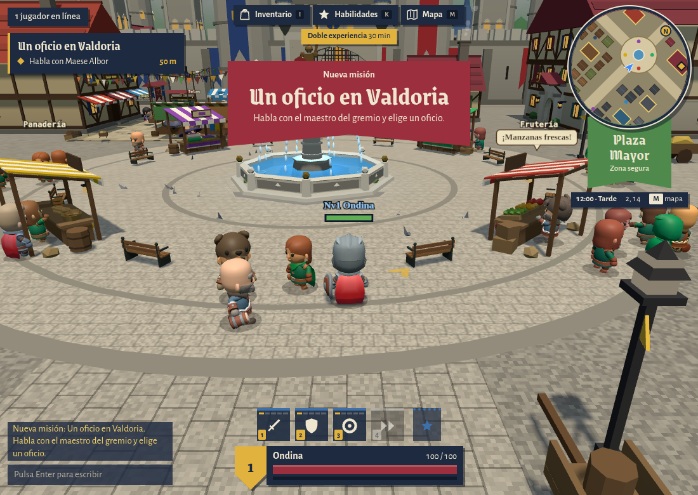

<sub><b>Plaza Mayor</b> · fuente, puestos del mercado, vecinos paseando, minimapa con el barrio actual y la misión en curso</sub>

</div>

## 📸 Capturas

<table>
  <tr>
    <td width="50%" align="center">
      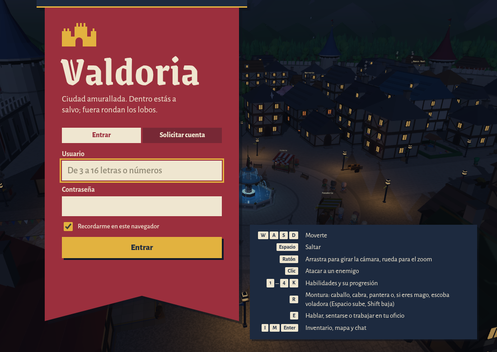
      <br /><sub><b>Inicio de sesión</b> · cuentas aprobadas por un administrador</sub>
    </td>
    <td width="50%" align="center">
      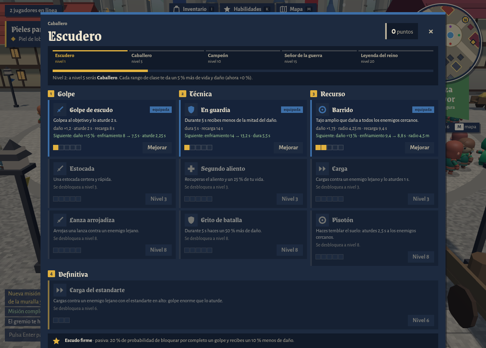
      <br /><sub><b>Habilidades</b> · rangos de clase, tres opciones por casilla y definitiva</sub>
    </td>
  </tr>
  <tr>
    <td width="50%" align="center">
      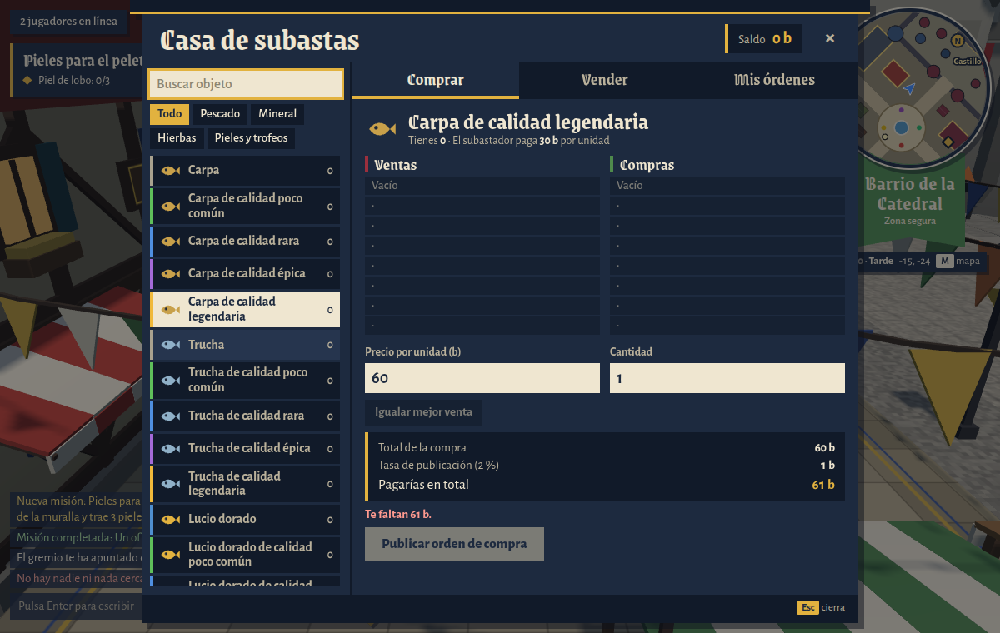
      <br /><sub><b>Casa de subastas</b> · los jugadores ponen precio a sus materiales</sub>
    </td>
    <td width="50%" align="center">
      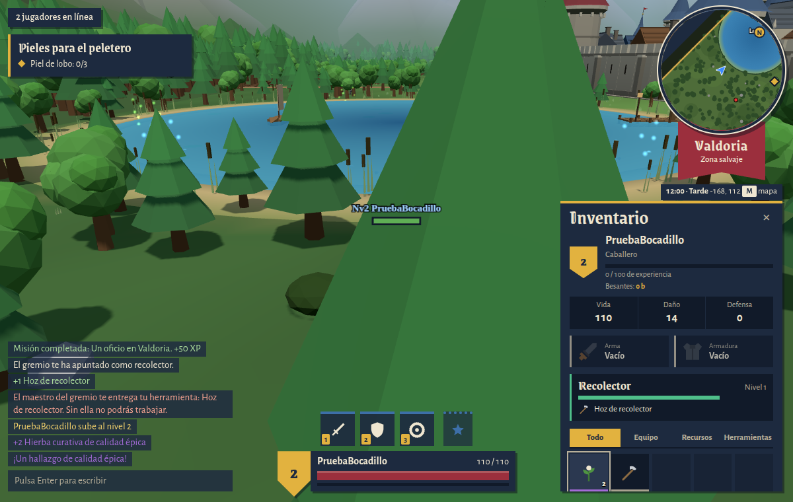
      <br /><sub><b>Inventario</b> · ficha, equipo, oficio y mochila con rarezas</sub>
    </td>
  </tr>
  <tr>
    <td width="50%" align="center">
      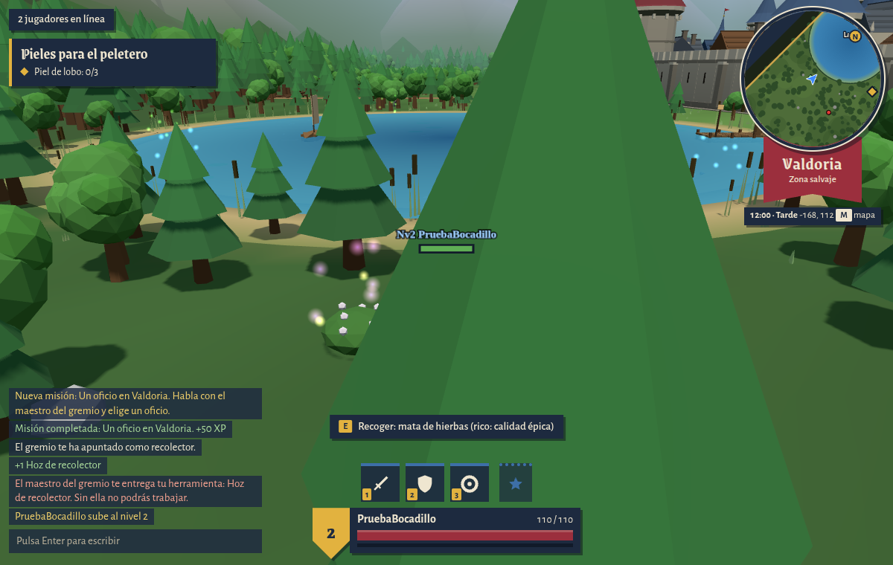
      <br /><sub><b>Recolección</b> · los puntos ricos brillan del color de su rareza</sub>
    </td>
    <td width="50%" align="center">
      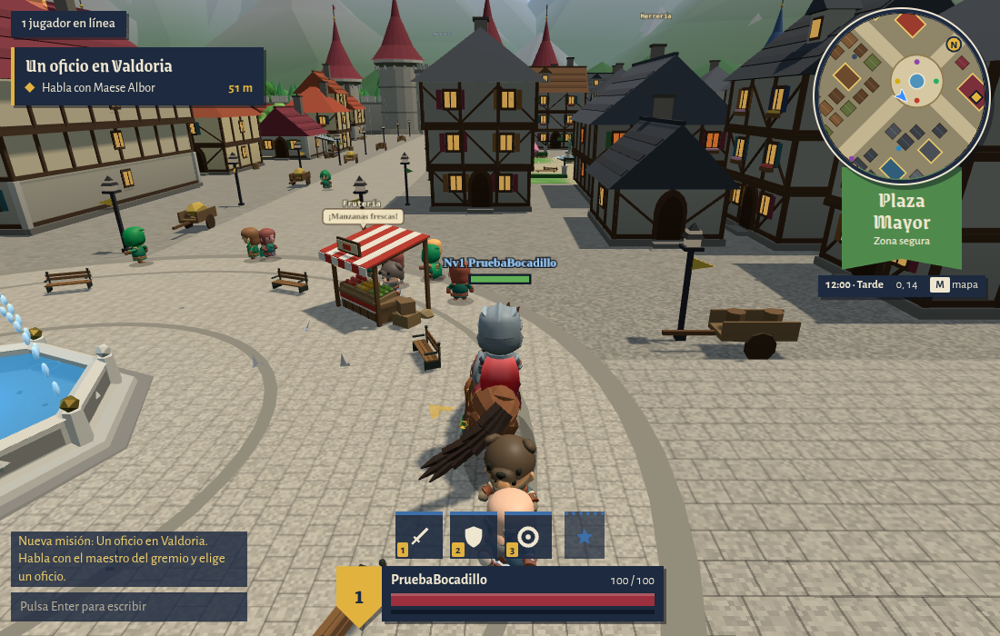
      <br /><sub><b>Monturas</b> · caballo, corcel sagrado, cabra, pantera y escoba voladora</sub>
    </td>
  </tr>
  <tr>
    <td width="50%" align="center">
      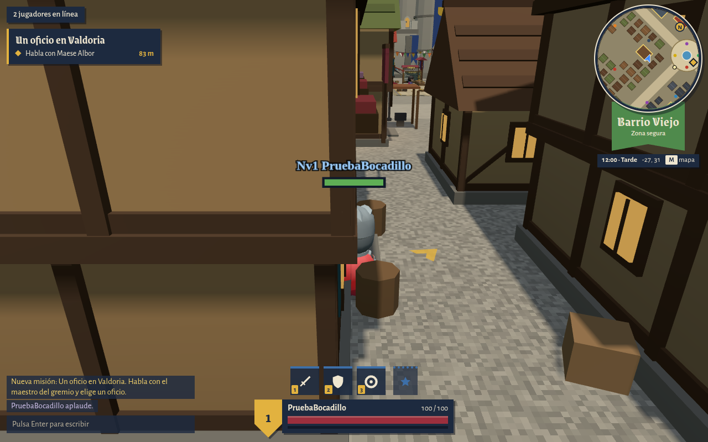
      <br /><sub><b>Barrio Viejo</b> · cada barrio tiene su estandarte, colores y vida</sub>
    </td>
    <td width="50%" align="center">
      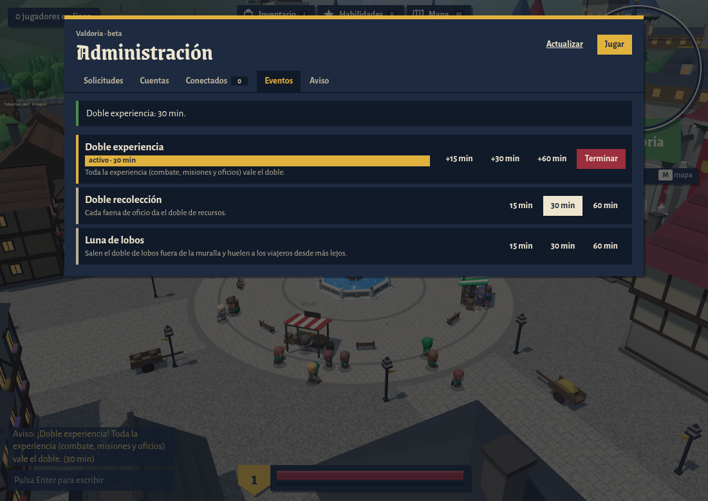
      <br /><sub><b>Panel de administración</b> · solicitudes, cuentas, expulsiones, avisos y eventos</sub>
    </td>
  </tr>
</table>

---

## Índice

- [Jugar](#-jugar)
- [Capturas](#-capturas)
- [Características](#-características)
- [Arquitectura](#️-arquitectura)
- [Seguridad](#-seguridad)
- [Stack tecnológico](#-stack-tecnológico)
- [Estructura del monorepo](#-estructura-del-monorepo)
- [Puesta en marcha local](#-puesta-en-marcha-local)
- [Variables de entorno](#-variables-de-entorno)
- [Scripts](#-scripts)
- [Despliegue](#️-despliegue)
- [Créditos](#-créditos)

---

## 🎮 Jugar

<!-- ENLACE -->
<div align="center">

### 👉 [homeless-ban-applying-night.trycloudflare.com](https://homeless-ban-applying-night.trycloudflare.com)

<sub>Actualizada el 17/11/2026. Mientras la beta no tenga dominio propio, la dirección cambia cuando se reinicia el servidor.</sub>

</div>
<!-- /ENLACE -->

1. Pulsa **Solicitar cuenta**, elige un usuario y, si quieres, deja un mensaje.
2. Cuando un administrador la apruebe te dará una **contraseña temporal**; al entrar por primera vez eliges la tuya.
3. Crea tu personaje (hasta 3 por cuenta) y aparecerás en la Plaza Mayor.

Funciona en navegadores de escritorio con WebGL (Chrome, Firefox, Edge y Safari).

<details>
<summary><b>Controles</b></summary>

<br />

| Tecla | Acción |
|-------|--------|
| <kbd>W</kbd> <kbd>A</kbd> <kbd>S</kbd> <kbd>D</kbd> | Moverte |
| <kbd>Espacio</kbd> | Saltar (subir, con la escoba; <kbd>Shift</kbd> baja) |
| Ratón | Arrastrar para girar la cámara; rueda para el zoom |
| Clic | Atacar o seleccionar |
| <kbd>1</kbd>–<kbd>4</kbd> | Habilidades (la 4 es la definitiva) |
| <kbd>R</kbd> | Montar o desmontar |
| <kbd>E</kbd> | Hablar, sentarse o trabajar en tu oficio |
| <kbd>F</kbd> | Rezar ante la estatua de la diosa |
| <kbd>I</kbd> · <kbd>K</kbd> · <kbd>M</kbd> | Inventario, habilidades y mapa |
| <kbd>Enter</kbd> | Chat y gestos: `/saludar`, `/aplaudir`, `/vitorear`, `/sentarse`, `/tumbarse` |

</details>

---

## ✨ Características

### 🏰 La ciudad

| | Función | Dónde | Descripción |
|---|---------|-------|-------------|
| 🏘️ | **Seis barrios** | Toda la ciudad | Plaza Mayor, Recinto del Castillo, Barrio de la Catedral, del Gremio, Viejo y del Yunque, con estandarte y rótulo al entrar |
| 👑 | **Castillo habitable** | Recinto del Castillo | Gran salón del trono con la Reina Isolda, el senescal Bertrand y la juglar Lira |
| ⛪ | **Catedral transitable** | Barrio de la Catedral | Nave hueca con la estatua de la diosa al fondo |
| 🌳 | **Parques y bancos** | Repartidos por los barrios | Sentado recuperas vida más deprisa; los vecinos pasean, charlan y se sientan |
| 🌗 | **Día y noche** | Todo el mundo | Ciclo compartido por todos: sol, luna, estrellas, nubes, farolas y ventanas encendidas |
| 🎵 | **Sonido ambiente** | Todo el mundo | Agua, pájaros, grillos, viento y hojas sintetizados en el navegador |

### ⚔️ Clases y progresión

| | Función | Tecla | Descripción |
|---|---------|-------|-------------|
| 🛡️ | **Cuatro clases** | Al crear personaje | Caballero, Bárbaro, Mago y Pícaro, con habilidades, pasiva y montura propias |
| ✨ | **Bendición de la diosa** | <kbd>F</kbd> | Rezar 21 s transforma al Caballero en **Paladín** y al Mago en **Mago de la Luz** |
| 🌟 | **Árbol de habilidades** | <kbd>K</kbd> | Tres casillas con tres opciones (se desbloquean a nivel 3 y 8), definitiva a nivel 6 y rangos hasta 5 |
| 🎖️ | **Rangos de clase** | <kbd>K</kbd> | Títulos por nivel (del Caballero: de Escudero a Leyenda del reino) que dan +5 % de vida y daño cada uno |
| 🐎 | **Monturas** | <kbd>R</kbd> | Caballo, corcel sagrado, cabra montesa, pantera sombría y escoba voladora |

### ⛏️ Oficios y economía

| | Función | Dónde | Descripción |
|---|---------|-------|-------------|
| 🎣 | **Cuatro oficios** | Gremio | Pescador, Peletero, Recolector y Minero, con su herramienta y su nivel |
| 💎 | **Rarezas** | Puntos de recolección | Común, poco común, rara, épica y legendaria; los puntos ricos brillan y las dan a menudo |
| ⚖️ | **Casa de subastas** | Plaza del mercado | Órdenes de compra y venta entre jugadores, tablón de precios y moneda propia (besantes) |
| 🎒 | **Inventario** | <kbd>I</kbd> | Ficha, equipo, oficio con su herramienta y mochila por pestañas |

### 🐺 Aventura

| | Función | Descripción |
|---|---------|-------------|
| 🐺 | **Lobos** | Fuera de la muralla, con persecución, botín y reaparición |
| 📜 | **Misiones** | Encadenadas, con NPCs que tienen diálogo, marcador `!` y flecha guía |
| 💬 | **Chat y gestos** | Los mensajes aparecen en un bocadillo sobre tu personaje |

### 🛡️ Administración de la beta

| | Función | Descripción |
|---|---------|-------------|
| 🛂 | **Solicitudes** | Aceptar o rechazar cuentas; al aceptar se genera una contraseña temporal |
| 👥 | **Cuentas** | Contraseña temporal nueva, bloquear y desbloquear |
| 🚪 | **Conectados** | Ver quién juega y expulsar |
| 🎉 | **Eventos del mundo** | Doble experiencia, doble recolección y luna de lobos, de 15 a 60 minutos |
| 📢 | **Avisos** | Cartel grande en pantalla para todos los conectados |

---

## 🏗️ Arquitectura

El servidor es **autoritativo**: los clientes solo envían intenciones (moverse, atacar, recolectar…) y el servidor simula el mundo a 20 ciclos por segundo, lo valida todo y difunde el estado. Cliente y servidor comparten las reglas y los datos del mundo en `@mmorpg/shared`.

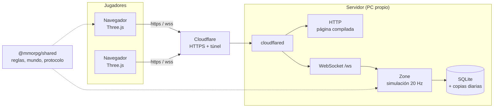

### Flujo de acceso

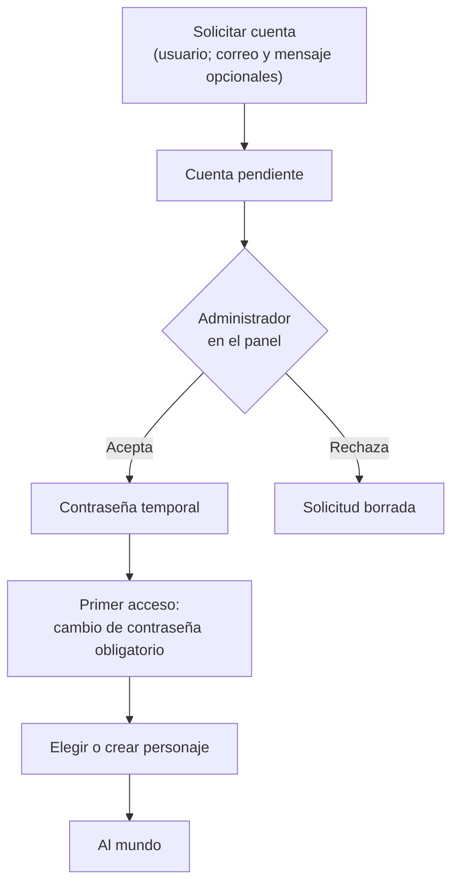

---

## 🔒 Seguridad

| Medida | Detalle | Dónde |
|--------|---------|-------|
| **Servidor autoritativo** | El cliente no decide daño, botín, posición ni dinero; el servidor valida distancias, enfriamientos, oficio, herramienta y saldo | `apps/server/src/zone.ts` |
| **Contraseñas** | scrypt con sal aleatoria por cuenta, calculado de forma asíncrona; comparación en tiempo constante | `apps/server/src/auth.ts` |
| **Sesiones** | Token aleatorio de 256 bits, guardado solo como hash SHA-256 y válido 30 días | `auth.ts`, `store.ts` |
| **Fuerza bruta** | Bloqueo de 1 minuto tras 5 fallos; el hash se calcula aunque el usuario no exista, para no delatarlo por el tiempo | `auth.ts` |
| **Beta por invitación** | Las cuentas nuevas no entran hasta que un administrador las aprueba; la contraseña temporal obliga a cambiarla | `auth.ts`, `ui/admin.ts` |
| **Límites de red** | Mensajes de 1 KB como máximo, 200 conexiones y 6 por IP real (`CF-Connecting-IP`); conexiones muertas fuera a los 30 s | `apps/server/src/main.ts` |
| **Cabeceras HTTP** | `X-Content-Type-Options`, `X-Frame-Options: DENY`, `Referrer-Policy` y `Permissions-Policy`; no se sirve nada fuera de la carpeta de la página | `apps/server/src/http.ts` |
| **HTTPS sin puertos abiertos** | El servidor solo escucha en `127.0.0.1`; desde Internet se entra únicamente por Cloudflare Tunnel | `deploy/` |
| **Aislamiento del proceso** | systemd: no ve la carpeta personal, el código es de solo lectura, solo escribe en `apps/server/data` y no tiene privilegios | `deploy/valdoria.service` |

---

## 🧰 Stack tecnológico

| Capa | Tecnología | Versión |
|------|-----------|---------|
| Cliente | Three.js (gráficos procedurales y modelos glTF) | 0.170.0 |
| | TypeScript | 5.9 |
| | Vite | 6.4 |
| | Interfaz en DOM y CSS propios (sin framework) | — |
| Servidor | Node.js con `node:sqlite` y `node:crypto` | 22 |
| | `ws` (WebSocket) | 8.23 |
| | `tsx` (ejecuta TypeScript) | 4.23 |
| Datos | SQLite con migración automática de columnas | — |
| Audio | WebAudio sintetizado | — |
| Despliegue | systemd + Cloudflare Tunnel (`cloudflared`) | — |

---

## 📁 Estructura del monorepo

Monorepo con npm workspaces.

```
.
├── packages/
│   └── shared/          # Reglas y datos comunes: clases, progresión, objetos, oficios, mercado, mundo, protocolo
├── apps/
│   ├── server/          # Simulación (zone.ts), cuentas (auth.ts), subastas (market.ts), SQLite (store.ts), HTTP (http.ts)
│   └── client/          # Three.js: mundo (world/), personajes y monturas (models/), interfaz (ui/)
├── deploy/              # Servicios systemd y guiones de instalación, actualización y dirección del túnel
├── tools/bots/          # Bots de carga y pruebas automáticas (mercado, rendimiento)
└── docs/                # Capturas, decisiones de diseño y medidas de rendimiento
```

---

## 🚀 Puesta en marcha local

**Requisitos previos**: Node.js 22 o posterior y npm.

```bash
# 1. Clona el repositorio
git clone https://github.com/Haise232/aetherfall-mmo.git
cd aetherfall-mmo

# 2. Instala las dependencias de todos los paquetes
npm install

# 3. Arranca servidor y cliente con recarga en caliente
npm run dev
```

Abre `http://localhost:5173`. La primera vez se crea la cuenta **`admin` / `admin`** y obliga a cambiar la contraseña al entrar.

> Para probar con bots sin cuentas: `ALLOW_GUEST=1 npm run dev:server`.

---

## 🔑 Variables de entorno

<details>
<summary><b>Servidor</b> (todas opcionales)</summary>

<br />

| Variable | Por defecto | Descripción |
|----------|-------------|-------------|
| `PORT` | `8787` | Puerto HTTP y WebSocket |
| `HOST` | `0.0.0.0` | Interfaz; detrás del túnel se usa `127.0.0.1` |
| `DB_PATH` | `data/game.db` | Base de datos SQLite |
| `ADMIN_PASSWORD` | `admin` | Contraseña de `admin` al crearla por primera vez |
| `ADMIN_RESET` | — | `1` devuelve `admin` a la contraseña inicial y obliga a cambiarla |
| `ALLOW_GUEST` | — | `1` permite entrar sin cuenta (solo pruebas locales) |
| `MAX_CONN` / `MAX_PER_IP` | `200` / `6` | Conexiones simultáneas en total y por IP |
| `BACKUP_DIR` / `BACKUP_KEEP` | `data/backups` / `14` | Carpeta de copias y cuántas se guardan |
| `STATIC_DIR` | `apps/client/dist` | Página compilada que sirve el servidor |
| `DEBUG_TICK` | — | `1` imprime cada 5 s el tiempo por ciclo, la CPU y el ancho de banda |

En el servicio se ponen en `/etc/valdoria.env`.

</details>

---

## 📜 Scripts

| Comando | Descripción |
|---------|-------------|
| `npm run dev` | Servidor (8787) y cliente Vite (5173) con recarga en caliente |
| `npm run typecheck` | Comprueba los tipos de todo el monorepo |
| `npm run build` | Comprueba tipos y compila el cliente en `apps/client/dist` |
| `npm start` | Servidor de producción: página compilada y juego en el mismo puerto |

<details>
<summary><b>Pruebas y medidas</b></summary>

<br />

| Comando | Descripción |
|---------|-------------|
| `npx tsx tools/bots/market-check.ts` | Pruebas automáticas de la casa de subastas |
| `npx tsx tools/bots/bench-step.ts` | Tiempo por ciclo y ancho de banda con 25, 50 y 100 jugadores |
| `npx tsx tools/bots/load.ts` | Bots conectados a un servidor real (con `ALLOW_GUEST=1`) |

Medido: con 25 jugadores cada ciclo tarda unos 1,6 ms de los 50 ms disponibles; con 100, unos 15 ms.

</details>

---

## ☁️ Despliegue

La beta corre en un PC propio con **Cloudflare Tunnel** delante: HTTPS gratuito, sin abrir puertos del router y sin mostrar la IP de casa.

```bash
sudo deploy/instalar.sh      # compila, instala el juego y el túnel como servicios y publica la dirección
deploy/direccion.sh          # muestra la dirección pública actual
deploy/publicar-direccion.sh # la escribe en este README y la sube a GitHub
deploy/actualizar.sh         # publica cambios: compila y reinicia (los jugadores se guardan y vuelven a entrar solos)
sudo deploy/desinstalar.sh   # quita los servicios (la base de datos se queda)
```

- **Arranque automático**: los servicios arrancan con el equipo y se reinician si se caen.
- **Copias de seguridad**: una al arrancar y otra cada día en `apps/server/data/backups` (las 14 últimas).
- **Apagado limpio**: al reiniciar se guarda a todos los conectados.
- Mientras no haya dominio propio, la dirección `trycloudflare.com` cambia al reiniciar el túnel.

---

## 🙏 Créditos

- Modelos de personaje: [KayKit: Adventurers Character Pack](https://github.com/KayKit-Game-Assets/KayKit-Character-Pack-Adventures-1.0) de Kay Lousberg (CC0).
- Tipografías: Grenze Gotisch y Alegreya Sans (SIL Open Font License).
- La ciudad, el castillo, los efectos, la interfaz y el sonido ambiente se generan por código.

---

<div align="center">

Hecho con dedicación por **[Haise232](https://github.com/Haise232)**

Si te gusta Valdoria, pide tu cuenta y nos vemos en la Plaza Mayor.

</div>
